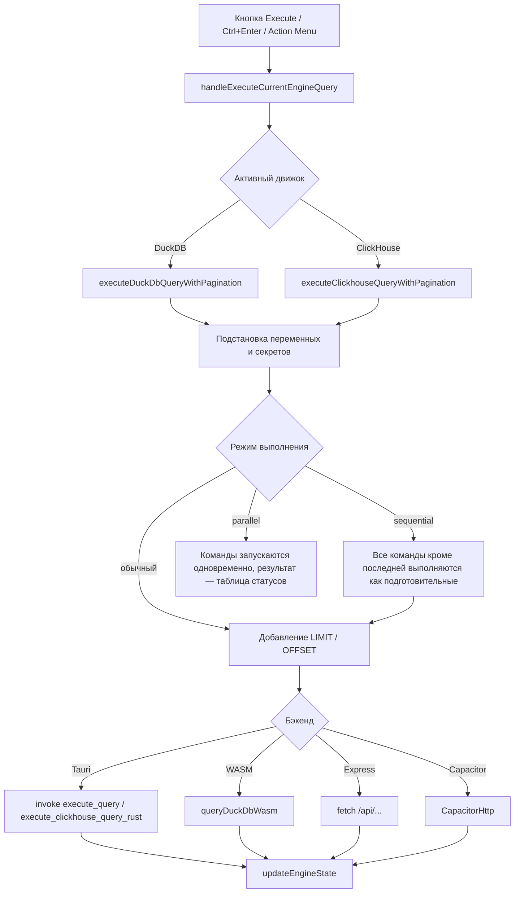

# Архитектура QueryAST Lens

Обзор того, как устроено приложение: откуда берутся результаты, где что хранится, как строятся графы и документы. English version: [ARCHITECTURE_EN.md](./ARCHITECTURE_EN.md). Список файлов с краткими описаниями — в [CONTRIBUTING](./CONTRIBUTING.md#project-architecture--key-files), хранение данных — в [DATA_AND_SECURITY](./DATA_AND_SECURITY.md).

## 1. Платформы и движки

Один и тот же интерфейс (React) работает в трёх оболочках:

| Оболочка | Как запускается | DuckDB | ClickHouse |
| :--- | :--- | :--- | :--- |
| **Десктоп** (Tauri 1, Rust) | `npm run tauri dev/build` | Нативный DuckDB в Rust (`src-tauri/src/main.rs`), доступ к файлам на диске; также доступен DuckDB-WASM | HTTP-клиент на Rust (`reqwest`) |
| **Android** (Capacitor 6) | `npx cap …` (папку `android/` создаёт CI) | DuckDB-WASM в WebView | `CapacitorHttp` (обходит CORS); `COPY FROM` недоступен |
| **Веб, режим разработки** | `npm run dev` (`server.ts`, Express + Vite) | Пакет `duckdb` на сервере (`/api/duckdb/*`) или DuckDB-WASM | Прокси сервера (`/api/clickhouse/*`) |

Определение среды: `isTauriEnvironment()` / `isCapacitorEnvironment()` (`src/lib/clickhouse.ts`) и флаг `isWasmMode` в `App.tsx`. Если ни Tauri, ни сервер Express недоступны, приложение переходит на DuckDB-WASM. Для обращений к серверу `fetchApiJson` пробует тот же адрес, затем `127.0.0.1`/`localhost` на портах 48291 и 3000.

## 2. Главный компонент

Почти вся логика состояния находится в одном компоненте `App()` (`src/App.tsx`, около 8 000 строк): вкладки, выполнение запросов, результаты, схема БД, граф, глобальные горячие клавиши, модальные окна. Вспомогательная логика вынесена в `src/utils`, `src/lib`, `src/editor`.

Особенности, о которых полезно знать при правках:
* Редактор и панель «Меню действий» отрисовываются в двух ветках JSX (обычный и развёрнутый макет, `isMaximizedSql`), поэтому изменения интерфейса редактора нужно вносить в обе.
* Глобальный обработчик клавиш (`keydown`, фаза перехвата) читает актуальные значения через `ref`-ы `current*`, потому что подписывается один раз (зависимость `[activeEngine]`). Новое действие добавляется: идентификатор и сочетание в `DEFAULT_HOTKEYS` (`SettingsModal.tsx`) → ветка в обработчике → обновление справочника в руководстве.
* Единый стиль локализации: ключ — русский текст, английский вариант в `EN_DICT` (`src/utils/i18n.ts`). Язык меняется перезагрузкой страницы.

## 3. Выполнение запроса



Порядок обработки текста запроса:
1. `replaceVariablesInSql` (`src/lib/sqlUtils.ts`): `{{$имя=значение}}` и `{{$имя}}`; определения ищутся в выполняемом тексте и во всём тексте вкладки.
2. `replaceSecretsInSql` (`src/utils/vaultStorage.ts`): `{{ИМЯ}}` из разблокированного Vault. Если в тексте есть `{{`, а хранилище заблокировано, выполнение прекращается с сообщением.
3. Для режимов `sequential`/`parallel` текст делится на команды (`splitBySemicolonIgnoringQuotes`).
4. Постраничный `LIMIT`/`OFFSET` (размер страницы — настройка `duckDbMaxRows` / `clickhouseMaxRows`, по умолчанию 100; `0` — без лимита). Если в тексте найден `LIMIT <число>`, лимит не добавляется на первой странице; на следующих страницах добавляется `OFFSET` (при собственном `LIMIT` или `UNION` — через подзапрос). ClickHouse дополнительно получает `FORMAT JSON` для `SELECT`/`SHOW`/`DESCRIBE`/`EXPLAIN`, если формат не указан.
5. `COPY … TO/FROM` для ClickHouse распознаётся до отправки (`parseClickhouseCopy`) и выполняется потоково на десктопе (Rust) либо через `CapacitorHttp` (только `TO`).
6. Для DuckDB после `CREATE/DROP/ATTACH/DETACH/RENAME` схема обновляется автоматически (настройка `autoUpdateSchema`).

Отмена: `AbortController` в интерфейсе плюс нативные команды `cancel_duckdb_query` (прерывание соединения DuckDB) и `cancel_clickhouse_query` (обрыв HTTP-запроса). Нативный слой DuckDB держит **одно** соединение под блокировкой, поэтому запросы выполняются по очереди.

Потолок результата — 500 000 строк на запрос (Rust, WASM и ClickHouse обрезают без уведомления).

## 4. Результаты и вкладки

* Вкладки: `EditorTab` (`src/types/editorTab.ts`), до 9 штук плюс служебная вкладка «Меню действий» (`ACTION_MENU_TAB_ID`).
* Состояние результата (строки, ошибка, длительность, типы колонок, страница) хранится на уровне `App` для активной вкладки. `updateEngineState` пишет его либо в состояние React (запрос пришёл в активную вкладку), либо в IndexedDB (`resultStorage`, запрос из фоновой вкладки); при переключении вкладки результат читается обратно (в памяти кэшируется 3 последних).
* Сортировка и фильтры в таблице строят SQL-обёртку `SELECT * FROM (<исходный запрос>) AS _filtered_query WHERE … ORDER BY …` (`filteredSql.ts`); при повторном применении предыдущая обёртка снимается, чтобы запросы не вкладывались друг в друга.
* Автоматическая выгрузка Excel при `@excel_save` запускается из `updateEngineState` (см. [EXCEL_DIRECTIVES](./EXCEL_DIRECTIVES.md)).

## 5. Схема БД

`fetchDuckDbSchema` и аналог для ClickHouse читают каталоги базы (для ClickHouse — `system.*`) и строят дерево схемы для панели и автодополнения. Результат кэшируется в IndexedDB (`schemaDbCache`), записи старше 7 дней очищаются.

## 6. SQL-граф

```
SQL (выделение или весь текст)
  → parseSqlToAst            (astToGraph.ts: деление на запросы, node-sql-parser + эвристики)
  → astToGraph               (узлы и рёбра: таблицы, CTE, подзапросы, JOIN, SELECT, Sort, Limit)
  → getLayoutedElements      (dagre; LR или TB)
  → React Flow               (CustomNodes.tsx; подсветка lineage в App.tsx)
```

* Разбор: грамматика PostgreSQL из `node-sql-parser` используется для всех диалектов; процедуры, `COPY`, `CREATE … AS`, `UNION`, DML и сложные `WITH` обрабатываются собственными эвристиками. Если разбор не удался, делается запасной разбор SELECT; запросы, не поддавшиеся разбору в многозапросном файле, пропускаются.
* Несколько запросов (`;`): блок каждого запроса раскладывается отдельно; при `LR` блоки идут друг под другом, при `TB` — вправо; над блоком стоит компактный заголовок «Query N» со сворачиванием. Рёбер между запросами нет.
* Экспорт графа: изображения (`graphExport.ts`, `html-to-image`; на время экспорта отключается отрисовка только видимых узлов), JSON, XML, Mermaid, Draw.io (`exportGraphText`).

## 7. Mermaid и Markdown

* Кнопка **Markdown**: если текст похож на чистый Mermaid (`looksLikeMermaid`), строится интерактивный граф (`mermaidParse.ts` → `mermaidToGraph.ts` с раскладкой dagre → узлы `MermaidNodes.tsx`, рёбра по маршруту раскладки). Иначе открывается документ.
* Документ: собственный рендерер `markdown.ts` (без внешних библиотек Markdown) → очистка DOMPurify → `MarkdownPreview.tsx`. Блоки ` ```mermaid ` рисуются статичным SVG (`mermaidSvg.ts`) на том же разборе; поддерживаются только `flowchart`/`graph`.
* Копирование в Word: обработчик `copy` формирует HTML (диаграммы — PNG в `data:`-адресах). Экспорт документа картинкой: `documentExport.ts` с ограничением размера холста `canvasLimits.ts`.
* Документ и граф в области графа не показываются одновременно: открытый документ скрывает граф.

## 8. Редактор SQL

`SqlEditor.tsx` — оболочка над CodeMirror 6 с прежним внешним интерфейсом (`SqlEditorRef`: `getSelection`, `replaceSelection`, `setSelectionRange`, `replaceRange`, `focus`, `openSearch`). Чистые операции над текстом (перемещение строк, регистр, вставка в начало/конец строк) вынесены в `src/editor/editorOps.ts` и покрыты тестами. Подсветка для просмотра ячеек и предпросмотра сниппетов вне редактора — `src/utils/sqlHighlight.ts`. Сочетания клавиш редактора сопоставляются через `src/editor/hotkeysMatch.ts`.

## 9. Excel

`exportToExcel` (`excelExporter.ts`): настройки → переопределения из директив → листы (разбиение, исключение колонок) → оформление, группировка, итоги → запись `exceljs` → сохранение (`exportUtils.downloadFileWithFallback`: диалог или заданный путь в Tauri, «Поделиться» на Android, скачивание в браузере). Подробности — [EXCEL_DIRECTIVES](./EXCEL_DIRECTIVES.md).

## 10. Хранение данных

Три слоя: `localStorage` (настройки, сессия), IndexedDB (результаты, версии, сниппеты, кэш схем, Vault) и файлы через Tauri (файл синхронизации, сохраняемые SQL и Excel). Полный перечень ключей, баз и правил синхронизации — в [DATA_AND_SECURITY](./DATA_AND_SECURITY.md).

## 11. Тесты и сборка

* Тесты: `tests/*.test.ts`, API Vitest (`npm test` или `bun test`). Покрыты чистые утилиты, хранилища (на `fake-indexeddb`), разбор и раскладка графов, Markdown, Mermaid, Excel (поверхностно). Не покрыты `App.tsx`, компоненты, DuckDB-WASM и Rust.
* Сборка и релиз: [CONTRIBUTING](./CONTRIBUTING.md#release-build-ci).
* Проверка типов: `npm run lint` (`tsc --noEmit`) охватывает только `src/**`; `server.ts` и `tests/` не проверяются.

## 12. Известные архитектурные ограничения

* Один большой компонент и два макета JSX (см. раздел 2).
* Три способа выполнения запроса (Tauri / WASM / Express) реализованы ветвлением внутри двух больших функций (`executeDuckDbQueryWithPagination`, `executeClickhouseQueryWithPagination`) без общего интерфейса; изменения нужно вносить во все ветки.
* В нативном слое ClickHouse общий слот отмены на все запросы (второй запрос может оборвать первый).
* Сообщения об ошибках экспорта графа/документа и ошибках разбора SQL в интерфейсе не отображаются (состояние `error` в `App.tsx` нигде не выводится).
