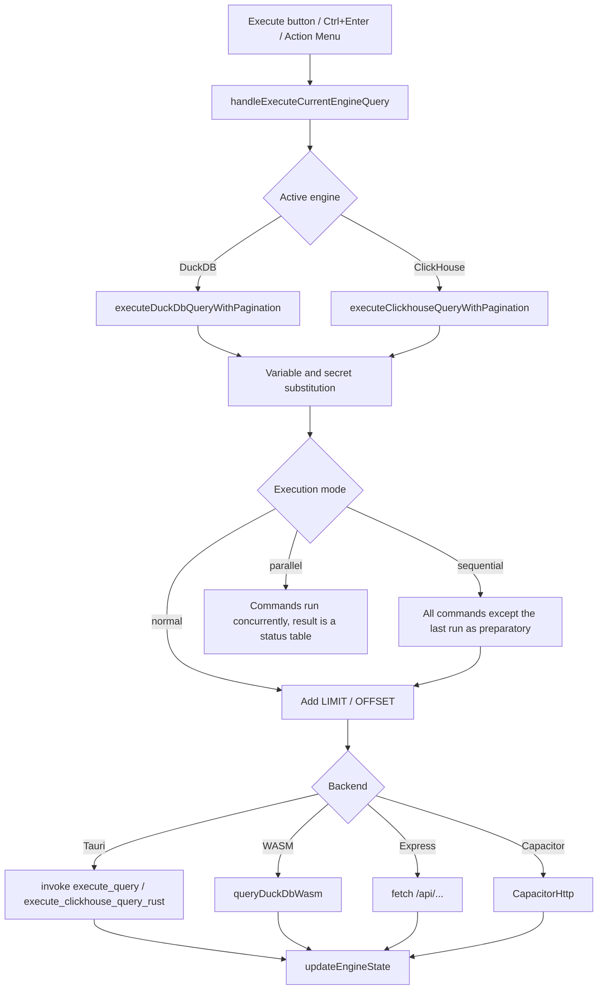

# QueryAST Lens Architecture

An overview of how the application works: where results come from, where data is stored, and how graphs and documents are built. For a file-by-file list see [CONTRIBUTING](./CONTRIBUTING.md#project-architecture--key-files); for data storage see [DATA_AND_SECURITY_EN](./DATA_AND_SECURITY_EN.md). Русская версия: [ARCHITECTURE.md](./ARCHITECTURE.md).

## 1. Platforms and engines

The same React interface runs in three shells:

| Shell | How it runs | DuckDB | ClickHouse |
| :--- | :--- | :--- | :--- |
| **Desktop** (Tauri 1, Rust) | `npm run tauri dev/build` | Native DuckDB in Rust (`src-tauri/src/main.rs`) with access to files on disk; DuckDB-WASM is also available | Rust HTTP client (`reqwest`) |
| **Android** (Capacitor 6) | `npx cap …` (the `android/` folder is created by CI) | DuckDB-WASM in the WebView | `CapacitorHttp` (bypasses CORS); `COPY FROM` is unavailable. Narrow layout, system Back button (`@capacitor/app`) |
| **Web, development mode** | `npm run dev` (`server.ts`, Express + Vite) | The `duckdb` package on the server (`/api/duckdb/*`) or DuckDB-WASM | Server proxy (`/api/clickhouse/*`) |

Environment detection: `isTauriEnvironment()` / `isCapacitorEnvironment()` (`src/lib/clickhouse.ts`) and the `isWasmMode` flag in `App.tsx`. If neither Tauri nor the Express server is available, the application falls back to DuckDB-WASM. For server calls, `fetchApiJson` tries the same origin, then `127.0.0.1`/`localhost` on ports 48291 and 3000.

## 2. The main component

Most state logic lives in a single `App()` component (`src/App.tsx`, about 8,000 lines): tabs, query execution, results, database schema, the graph, global hotkeys and modal windows. Supporting logic is extracted to `src/utils`, `src/lib` and `src/editor`.

Things worth knowing when making changes:
* The editor and the "Action Menu" panel are rendered in two JSX branches (normal and maximized layout, `isMaximizedSql`), so editor UI changes must be made in both.
* The global key handler (`keydown`, capture phase) reads current values through `current*` refs because it subscribes once (dependency `[activeEngine]`). To add an action: add an id and shortcut to `DEFAULT_HOTKEYS` (`SettingsModal.tsx`) → add a branch in the handler → update the shortcut reference in the guide.
* A narrow screen (width up to 767 px, like Tailwind's `max-md:`) is detected by window width, not by platform: `useIsNarrow` (`src/utils/useIsNarrow.ts`, a single `matchMedia` subscription) in components and `isNarrowNow()` in handlers. Layout changes use the `max-md:` classes and `narrow-scroll-x` (`index.css`: a toolbar in one row scrolled by finger); from 768 px wide the layout is unchanged. On a narrow screen either the editor or the graph is shown, and the schema panel slides in from the right. The Android Back button (`backPressRef` in `App.tsx`, Capacitor only) closes, in order: menus and confirmations → dialogs → the selected cell → the result table in the expanded editor → otherwise it minimizes the app.
* Localization: the key is the Russian text, the English variant lives in `EN_DICT` (`src/utils/i18n.ts`). The language changes by reloading the page.

## 3. Query execution



Query text processing order:
1. `replaceVariablesInSql` (`src/lib/sqlUtils.ts`): `{{$name=value}}` and `{{$name}}`; definitions are searched in the executed text and in the whole tab text.
2. `replaceSecretsInSql` (`src/utils/vaultStorage.ts`): `{{NAME}}` from the unlocked Vault. If the text contains `{{` and the Vault is locked, execution stops with a message.
3. For `sequential`/`parallel` modes the text is split into commands (`splitBySemicolonIgnoringQuotes`).
4. Paged `LIMIT`/`OFFSET` (page size is the `duckDbMaxRows` / `clickhouseMaxRows` setting, default 100; `0` means no limit). If the text contains `LIMIT <number>`, no limit is added on the first page; on following pages `OFFSET` is added (through a subquery when the query has its own `LIMIT` or a `UNION`). ClickHouse additionally gets `FORMAT JSON` for `SELECT`/`SHOW`/`DESCRIBE`/`EXPLAIN` when no format is specified.
5. ClickHouse `COPY … TO/FROM` is recognized before sending (`parseClickhouseCopy`) and executed as a stream on desktop (Rust) or through `CapacitorHttp` (`TO` only).
6. For DuckDB, after `CREATE/DROP/ATTACH/DETACH/RENAME` the schema is refreshed automatically (the `autoUpdateSchema` setting).

Cancellation: an `AbortController` in the interface plus the native commands `cancel_duckdb_query` (interrupts the DuckDB connection) and `cancel_clickhouse_query` (aborts the HTTP request). The native DuckDB layer holds **one** connection under a lock, so queries run one at a time.

The result cap is 500,000 rows per query (Rust, WASM and ClickHouse); above that the query ends with an error instead of a truncated result.

## 4. Results and tabs

* Tabs: `EditorTab` (`src/types/editorTab.ts`), up to 9, plus the service "Action Menu" tab (`ACTION_MENU_TAB_ID`).
* The result state (rows, error, duration, column types, page) is kept at the `App` level for the active tab. `updateEngineState` writes it either to React state (the query came from the active tab) or to IndexedDB (`resultStorage`, a query from a background tab); on tab switch the result is read back (the 3 most recent are cached in memory).
* Sorting and filters in the table build an SQL wrapper `SELECT * FROM (<original query>) AS _filtered_query WHERE … ORDER BY …` (`filteredSql.ts`); when applied again, the previous wrapper is removed so queries do not nest.
* The automatic Excel export for `@excel_save` is triggered from `updateEngineState` (see [EXCEL_DIRECTIVES_EN](./EXCEL_DIRECTIVES_EN.md)).

## 5. Database schema

`fetchDuckDbSchema` and its ClickHouse counterpart read the database catalogs (`system.*` for ClickHouse) and build the schema tree for the panel and autocomplete. The result is cached in IndexedDB (`schemaDbCache`); entries older than 7 days are purged.

### File tree

The lower part of the "Schema and files" panel is `FileTreePanel.tsx`. The pure logic is in `src/utils/fileTree.ts` (sorting, filtering, name checks, `planMove`, path remapping `remapPath`). The list comes from a `FileTreeProvider`: in Tauri (`createTauriProvider`, `fileTreeProviders.ts`) folders are read by the Rust command `list_dir`; in the browser and on Android (`createVfsProvider`) it is the DuckDB-WASM virtual file system, without file operations. The operations (`ops`: show in file manager, "Open with…", rename, move into a folder, move to trash) exist only for the Tauri provider and are implemented by the commands in `src-tauri/src/fstree.rs`: `reveal_path`, `open_with`, `rename_path`, `move_path`, `trash_path`. After a rename or move, `App.handleTreePathChanged` rewrites the `filePath` of tabs opened from those files. Dragging a file into the editor carries `text/plain` (the quoted path); a move inside the tree uses a separate data type, `application/x-queryast-path`. The move target is a folder (for a file, its folder; for empty space, the root), and a failure is shown as a brief red highlight of the target. The sort order is stored in the session (`SavedSession.filesSort`).

## 6. SQL graph

```
SQL (selection or whole text)
  → parseSqlToAst            (astToGraph.ts: query splitting, node-sql-parser + heuristics)
  → astToGraph               (cards for sources (table, CTE, subquery) and the result; JOIN as labeled arrows; WHERE, GROUP BY, HAVING, ORDER BY, LIMIT as chips on cards; frames around CTEs and subqueries)
  → getLayoutedElements      (dagre per block + orthogonal arrow routes: treeLayout.ts, edgePath.ts; LR or TB)
  → React Flow               (CustomNodes.tsx; lineage highlighting in App.tsx)
```

* Parsing: the PostgreSQL grammar from `node-sql-parser` is used for all dialects; procedures, `COPY`, `CREATE … AS`, `UNION`, DML and complex `WITH` are handled by custom heuristics. If parsing fails, a fallback SELECT parse is attempted; queries that cannot be parsed in a multi-query file are skipped.
* Multiple queries (`;`): each query's block is laid out separately; with `LR` blocks are stacked vertically, with `TB` they go to the right; a compact "Query N" header with collapse sits above each block. There are no edges between queries.
* Graph export: images (`graphExport.ts`, `html-to-image`; viewport-only node rendering is disabled during export), JSON, XML, Mermaid, Draw.io (`exportGraphText`).

## 7. Mermaid and Markdown

* The **Markdown** button: if the text looks like pure Mermaid (`looksLikeMermaid`), an interactive graph is built (`mermaidParse.ts`, or `erParse.ts` for `erDiagram` → `mermaidToGraph.ts` with dagre layout → `edgePath.ts`: ports on node sides and orthogonal lines: bends in the gaps between columns, merge buses, back-edge corridors, labels beside the line; `direction` in a subgraph = separate layout → `MermaidNodes.tsx` nodes and edges). Otherwise a document opens.
* Document: a custom renderer `markdown.ts` (no external Markdown libraries) → DOMPurify sanitization → `MarkdownPreview.tsx`. ` ```mermaid ` blocks are drawn as static SVG (`mermaidSvg.ts`) using the same parser; `flowchart`/`graph` and `erDiagram` are supported; edge geometry (`edgePath.ts`) is shared with the interactive graph.
* Copy to Word: a `copy` handler produces HTML (diagrams as PNG in `data:` URLs). Document export as an image: `documentExport.ts` with canvas size limits from `canvasLimits.ts`.
* A document and the graph are not shown in the graph area at the same time: an open document hides the graph.

## 8. SQL editor

`SqlEditor.tsx` is a wrapper around CodeMirror 6 that keeps the original external interface (`SqlEditorRef`: `getSelection`, `replaceSelection`, `setSelectionRange`, `replaceRange`, `focus`, `openSearch`). Pure text operations (moving lines, changing case, inserting at line start/end) live in `src/editor/editorOps.ts` and are covered by tests. Highlighting for cell viewing and snippet previews outside the editor is in `src/utils/sqlHighlight.ts`. Editor shortcuts are matched through `src/editor/hotkeysMatch.ts`.

## 9. Excel

`exportToExcel` (`excelExporter.ts`): settings → overrides from directives → sheets (splitting, column exclusion) → styling, grouping, totals → writing with `exceljs` → saving (`exportUtils.downloadFileWithFallback`: a dialog or a given path in Tauri, "Share" on Android, a download in the browser). With `@template` / `@template_values` (desktop) an existing `.xlsx` is read and filled at the `[[table]]` / `[[rows]]` marker instead (`excelTemplate.ts`). See [EXCEL_DIRECTIVES_EN](./EXCEL_DIRECTIVES_EN.md) for details.

## 10. Data storage

Three layers: `localStorage` (settings, session), IndexedDB (results, versions, snippets, schema cache, Vault) and files through Tauri (the sync file, saved SQL and Excel). The full list of keys, databases and sync rules is in [DATA_AND_SECURITY_EN](./DATA_AND_SECURITY_EN.md).

## 11. Tests and build

* Tests: `tests/*.test.ts`, Vitest API (`npm test` or `bun test`). They cover pure utilities, storages (on `fake-indexeddb`), graph parsing and layout, Markdown, Mermaid and Excel (superficially). Not covered: `App.tsx`, components, DuckDB-WASM and Rust.
* Build and release: [CONTRIBUTING](./CONTRIBUTING.md#release-build-ci).
* Type checking: `npm run lint` (`tsc --noEmit`) covers only `src/**`; `server.ts` and `tests/` are not checked.

## 12. Known architectural limitations

* One large component and two JSX layouts (see section 2).
* The three ways of executing a query (Tauri / WASM / Express) are implemented as branching inside two large functions (`executeDuckDbQueryWithPagination`, `executeClickhouseQueryWithPagination`) with no shared interface; changes must be made in all branches.
* The native ClickHouse layer has a single shared cancellation slot for all queries (a second query can abort the first).
* Errors from graph/document export and SQL parse errors are not shown in the interface (the `error` state in `App.tsx` is not rendered anywhere).
